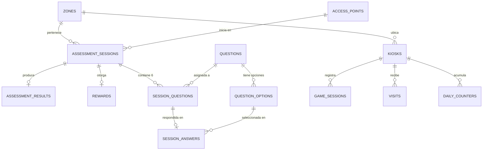

# Diccionario de Datos — CCLAS (Collaborative Community Literacy Assessment System)

Este documento describe de forma integral el esquema de base de datos relacional (PostgreSQL / SQLAlchemy ORM) del sistema **CCLAS**, incluyendo tablas de catálogo, flujo de evaluación estructurado, flujo gamificado (*La Ruta de Nina*), métricas anónimas de visitas, llaves primarias y foráneas, y restricciones de integridad (`CHECK` y `UNIQUE`).

> **Privacidad por Diseño (Ley 81 de Panamá):** Ninguna tabla almacena Información de Identificación Personal (PII) como nombres, cédulas, correos electrónicos, teléfonos, direcciones IP o huellas de dispositivos. Todos los datos demográficos y geográficos se registran exclusivamente mediante códigos canónicos cerrados.

---

## 1. Catálogos Geográficos y Puntos de Acceso

### 1.1 Tabla: `zones`
Catálogo oficial de zonas comunitarias (`Z001`–`Z036`) y código especial `DECLINED` cuando el participante opta por no compartir su ubicación.

| Columna | Tipo SQL | Nulable | Llave / Índice | Descripción y Restricciones |
| :--- | :--- | :--- | :--- | :--- |
| `code` | `VARCHAR(4)` / `VARCHAR` | `NOT NULL` | **PK** | Código canónico de la zona (`Z001` a `Z036`, o `DECLINED`). |
| `name` | `VARCHAR(80)` | `NOT NULL` | — | Nombre oficial del corregimiento o zona comunitaria. |
| `latitude` | `DOUBLE PRECISION` | `NULL` | — | Latitud geográfica referencial del centroide de la zona. |
| `longitude` | `DOUBLE PRECISION` | `NULL` | — | Longitud geográfica referencial del centroide de la zona. |

---

### 1.2 Tabla: `access_points`
Puntos de acceso autorizados desde los cuales se inician las sesiones de evaluación.

| Columna | Tipo SQL | Nulable | Llave / Índice | Descripción y Restricciones |
| :--- | :--- | :--- | :--- | :--- |
| `code` | `VARCHAR` | `NOT NULL` | **PK** | Código del punto de acceso: `'PTYK001'`, `'PTYK002'`, `'PTYK003'` o `'DIRECT_WEB'`. |
| `name` | `VARCHAR` | `NOT NULL` | — | Nombre descriptivo del punto de acceso (`trim(name) != ''`). |
| `type` | `ENUM(AccessPointType)` | `NOT NULL` | — | Tipo de canal: `'KIOSK'` o `'WEB'`. |

**Restricciones `CHECK`:**
- `ck_access_points_code`: `code IN ('PTYK001', 'PTYK002', 'PTYK003', 'DIRECT_WEB')`
- `ck_access_points_name`: `trim(name) != ''`
- `ck_access_points_code_type`: `(code = 'DIRECT_WEB' AND type = 'WEB') OR (code IN ('PTYK001', 'PTYK002', 'PTYK003') AND type = 'KIOSK')`

---

### 1.3 Tabla: `kiosks`
Catálogo de kioscos físicos (*Smart Oasis Kiosks*) y canal web para el flujo gamificado y conteo de visitas.

| Columna | Tipo SQL | Nulable | Llave / Índice | Descripción y Restricciones |
| :--- | :--- | :--- | :--- | :--- |
| `code` | `VARCHAR(20)` | `NOT NULL` | **PK** | Identificador del kiosco (ej. `PTYK001`, `PTYK002`, `PTYK003`, `DIRECT_WEB`). |
| `name` | `VARCHAR(80)` | `NOT NULL` | — | Nombre de ubicación del kiosco. |
| `zone_code` | `VARCHAR(4)` | `NULL` | **FK** → `zones.code`, **IDX** | Zona donde se ubica el kiosco (`fk_kiosks_zone_code_zones`). |

---

## 2. Flujo de Evaluación Estructurada y Banco de Preguntas

### 2.1 Tabla: `assessment_sessions`
Registra cada sesión de evaluación iniciada por un participante junto con su perfil demográfico anónimo.

| Columna | Tipo SQL | Nulable | Llave / Índice | Descripción y Restricciones |
| :--- | :--- | :--- | :--- | :--- |
| `session_id` | `INTEGER` | `NOT NULL` | **PK** | Identificador único autoincremental de la sesión. |
| `access_point_code` | `VARCHAR` | `NOT NULL` | **FK** → `access_points.code` | Punto de acceso desde donde se inició la sesión. |
| `assisted_mode` | `BOOLEAN` | `NOT NULL` | — | Indica si contó con apoyo de un facilitador (`true`/`false`). |
| `age_range` | `ENUM(AgeRange)` | `NOT NULL` | — | Rango de edad: `'18_24'`, `'25_34'`, `'35_49'`, `'50_59'`, `'60_PLUS'`. |
| `work_status` | `ENUM(WorkStatus)` | `NOT NULL` | — | Situación laboral: `'FORMAL'`, `'INFORMAL'`, `'HOME'`, `'STUDENT'`, `'UNEMPLOYED'`. |
| `schooling_level` | `ENUM(SchoolingLevel)` | `NOT NULL` | — | Nivel educativo: `'PRIMARY_INCOMPLETE'`, `'PRIMARY_COMPLETE'`, `'SECONDARY_INCOMPLETE'`, `'SECONDARY_COMPLETE'`, `'TERTIARY'`. |
| `zone_code` | `VARCHAR` | `NOT NULL` | **FK** → `zones.code` | Código de zona (`Z001`–`Z036` o `'DECLINED'`). |
| `location_declined` | `BOOLEAN` | `NOT NULL` | — | `true` si y solo si `zone_code = 'DECLINED'`. |
| `completion_status` | `ENUM(CompletionStatus)` | `NOT NULL` | — | Estado de la sesión: `'IN_PROGRESS'`, `'COMPLETED'`, `'ABANDONED'`. |
| `duration_seconds` | `INTEGER` | `NOT NULL` | — | Duración total en segundos (`>= 0`). |

**Restricciones `CHECK`:**
- `ck_assessment_sessions_duration_seconds`: `duration_seconds >= 0`
- `ck_assessment_sessions_zone_location_declined`: `(zone_code = 'DECLINED' AND location_declined = true) OR (zone_code != 'DECLINED' AND location_declined = false)`

---

### 2.2 Tabla: `questions`
Banco de preguntas categorizadas por competencia de literacidad.

| Columna | Tipo SQL | Nulable | Llave / Índice | Descripción y Restricciones |
| :--- | :--- | :--- | :--- | :--- |
| `id` | `INTEGER` | `NOT NULL` | **PK**, **IDX** | Identificador único de la pregunta. |
| `category` | `VARCHAR` | `NOT NULL` | — | Categoría de competencia: `'R1'`, `'R2'`, `'R3'`, `'R4'` (o `'test'`). |
| `question_text` | `VARCHAR` | `NULL` | — | Enunciado de la pregunta. |
| `assessment_id` | `INTEGER` | `NULL` | **FK** → `assessments.id` | Referencia opcional a plantilla de evaluación legada. |
| `question_type` | `VARCHAR` | `NULL` | — | Tipo de pregunta (opcional). |
| `correct_answer` | `VARCHAR` | `NULL` | — | Valor de referencia de respuesta correcta (opcional). |
| `points` | `INTEGER` | `NULL` | — | Puntaje asignado a la pregunta. |

**Restricciones `CHECK`:**
- `ck_questions_category`: `category IN ('R1', 'R2', 'R3', 'R4', 'test')`

---

### 2.3 Tabla: `question_options`
Opciones de respuesta para cada pregunta del banco.

| Columna | Tipo SQL | Nulable | Llave / Índice | Descripción y Restricciones |
| :--- | :--- | :--- | :--- | :--- |
| `id` | `INTEGER` | `NOT NULL` | **PK** | Identificador único de la opción. |
| `question_id` | `INTEGER` | `NOT NULL` | **FK** → `questions.id` | Pregunta a la que pertenece la opción. |
| `option_text` | `TEXT` | `NOT NULL` | — | Texto de la opción (`length(trim(option_text)) > 0`). |
| `is_correct` | `BOOLEAN` | `NOT NULL` | — | Indica si es la opción correcta (`DEFAULT false`). |

**Restricciones e Índices:**
- `uq_question_options_question_id_id`: `UNIQUE (question_id, id)` (soporte para FK compuesta desde `session_answers`).
- `ck_question_options_text_not_empty`: `CHECK (length(trim(option_text)) > 0)`
- `uq_one_correct_option_per_question`: Índice único parcial (`WHERE is_correct = true`) que garantiza una sola respuesta correcta por pregunta.

---

### 2.4 Tabla: `session_questions`
Asignación de las 6 preguntas seleccionadas para una sesión de evaluación específica.

| Columna | Tipo SQL | Nulable | Llave / Índice | Descripción y Restricciones |
| :--- | :--- | :--- | :--- | :--- |
| `session_id` | `INTEGER` | `NOT NULL` | **PK**, **FK** → `assessment_sessions.session_id` | Sesión de evaluación. |
| `question_id` | `INTEGER` | `NOT NULL` | **PK**, **FK** → `questions.id` | Pregunta asignada a la sesión. |
| `position` | `INTEGER` | `NOT NULL` | — | Orden de presentación de la pregunta (`1` a `6`). |

**Restricciones:**
- `uq_session_question_position`: `UNIQUE (session_id, position)`
- `ck_session_question_position`: `CHECK (position BETWEEN 1 AND 6)`

---

### 2.5 Tabla: `session_answers`
Respuestas seleccionadas por el participante para cada pregunta asignada a su sesión.

| Columna | Tipo SQL | Nulable | Llave / Índice | Descripción y Restricciones |
| :--- | :--- | :--- | :--- | :--- |
| `session_id` | `INTEGER` | `NOT NULL` | **PK** | Identificador de la sesión. |
| `question_id` | `INTEGER` | `NOT NULL` | **PK** | Identificador de la pregunta respondida. |
| `option_id` | `INTEGER` | `NOT NULL` | — | Opción seleccionada por el participante. |

**Llaves Foráneas Compuestas:**
- `fk_session_answer_question`: `FOREIGN KEY (session_id, question_id) REFERENCES session_questions (session_id, question_id)`
- `fk_session_answer_option`: `FOREIGN KEY (question_id, option_id) REFERENCES question_options (question_id, id)` (garantiza a nivel de motor de base de datos que la opción elegida pertenezca a esa pregunta).

---

### 2.6 Tabla: `assessment_results`
Puntajes desglosados por competencia y clasificación semafórica final de la evaluación.

| Columna | Tipo SQL | Nulable | Llave / Índice | Descripción y Restricciones |
| :--- | :--- | :--- | :--- | :--- |
| `id` | `INTEGER` | `NOT NULL` | **PK**, **IDX** | Identificador único del resultado. |
| `session_id` | `INTEGER` | `NULL` | **FK** → `assessment_sessions.session_id` | Sesión evaluada. |
| `submission_id` | `INTEGER` | `NULL` | **FK** → `assessment_submissions.id` | Envío legado opcional. |
| `c1_visual_signs_score` | `SMALLINT` | `NOT NULL` | — | Puntaje en C1: Señales visuales (`0` a `2`, `DEFAULT 0`). |
| `c2_sentence_comprehension_score` | `SMALLINT` | `NOT NULL` | — | Puntaje en C2: Comprensión de oraciones (`0` a `2`, `DEFAULT 0`). |
| `c3_mobile_icons_score` | `SMALLINT` | `NOT NULL` | — | Puntaje en C3: Iconos móviles (`0` a `2`, `DEFAULT 0`). |
| `c4_cybersecurity_score` | `SMALLINT` | `NOT NULL` | — | Puntaje en C4: Ciberseguridad (`0` a `3`, `DEFAULT 0`). |
| `total_literacy_score` | `SMALLINT` | `NOT NULL` | — | Puntaje total acumulado (`0` a `9`, `DEFAULT 0`). |
| `literacy_classification` | `ENUM(LiteracyClassification)` | `NOT NULL` | — | Clasificación semafórica: `'RED'` (`0–3`), `'YELLOW'` (`4–6`), `'GREEN'` (`7–9`). |
| `literacy_score` | `INTEGER` | `NULL` | — | Campo de compatibilidad legada. |
| `total_score` | `INTEGER` | `NULL` | — | Campo de compatibilidad legada. |
| `digital_score` | `INTEGER` | `NULL` | — | Campo de compatibilidad legada. |
| `priority_level` | `INTEGER` | `NULL` | — | Nivel de prioridad de intervención (compatibilidad legada). |

---

### 2.7 Tabla: `rewards`
Registro de recompensas comunitarias e incentivos IoT emitidos al completar una sesión.

| Columna | Tipo SQL | Nulable | Llave / Índice | Descripción y Restricciones |
| :--- | :--- | :--- | :--- | :--- |
| `id` | `INTEGER` | `NOT NULL` | **PK** | Identificador único de la recompensa. |
| `session_id` | `INTEGER` | `NOT NULL` | **FK** → `assessment_sessions.session_id`, **UNIQUE** | Sesión asociada (máximo una recompensa por sesión). |
| `trigger_type` | `ENUM(TriggerType)` | `NOT NULL` | — | Tipo de activación IoT: `'BEVERAGE_DISPENSER'`, `'WIFI_CREDENTIAL'`, `'POWER_STATION'`, `'NONE'`. |
| `issued` | `BOOLEAN` | `NOT NULL` | — | Indica si la recompensa fue efectivamente emitida. |

**Restricciones `CHECK`:**
- `ck_rewards_issued_trigger_type`: `(issued = false AND trigger_type = 'NONE') OR (issued = true AND trigger_type != 'NONE')`

---

## 3. Flujo Gamificado PWA (*La Ruta de Nina*) y Telemetría de Visitas

### 3.1 Tabla: `game_sessions`
Almacena de forma autónoma e idempotente cada partida anónima enviada desde la PWA gamificada (`POST /api/sessions`).

| Columna | Tipo SQL | Nulable | Llave / Índice | Descripción y Restricciones |
| :--- | :--- | :--- | :--- | :--- |
| `session_id` | `VARCHAR(40)` | `NOT NULL` | **PK** | ID aleatorio generado en el cliente (ej. `SES-...`). |
| `kiosk_id` | `VARCHAR(20)` | `NOT NULL` | **FK** → `kiosks.code`, **IDX** | Kiosco o punto de origen (`fk_game_sessions_kiosk_id_kiosks`). |
| `origin` | `VARCHAR(10)` | `NOT NULL` | — | Origen de la sesión: `'KIOSK'`, `'UNKNOWN'`, `'MOCK'`. |
| `assisted_mode` | `BOOLEAN` | `NOT NULL` | — | Indica si jugó en modo asistido (`DEFAULT false`). |
| `age_range` | `VARCHAR(10)` | `NULL` | — | `'18_24'`, `'25_34'`, `'35_49'`, `'50_59'`, `'60_PLUS'`. |
| `work_status` | `VARCHAR(15)` | `NULL` | — | `'FORMAL'`, `'INFORMAL'`, `'HOME'`, `'STUDENT'`, `'UNEMPLOYED'`. |
| `schooling_level` | `VARCHAR(25)` | `NULL` | — | `'PRIMARY_INCOMPLETE'`, `'PRIMARY_COMPLETE'`, `'SECONDARY_INCOMPLETE'`, `'SECONDARY_COMPLETE'`, `'TERTIARY'`. |
| `zone_code` | `VARCHAR(10)` | `NULL` | **IDX** | `'Z001'`–`'Z036'` o `'DECLINED'`. |
| `c1_visual_signs_score` | `SMALLINT` | `NOT NULL` | — | Puntaje C1 (`BETWEEN 0 AND 2`). |
| `c2_sentence_comprehension_score` | `SMALLINT` | `NOT NULL` | — | Puntaje C2 (`BETWEEN 0 AND 2`). |
| `c3_mobile_icons_score` | `SMALLINT` | `NOT NULL` | — | Puntaje C3 (`BETWEEN 0 AND 2`). |
| `c4_cybersecurity_score` | `SMALLINT` | `NOT NULL` | — | Puntaje C4 (`BETWEEN 0 AND 3`). |
| `total_literacy_score` | `SMALLINT` | `NOT NULL` | — | Suma exacta de `c1 + c2 + c3 + c4` (`BETWEEN 0 AND 9`). |
| `internal_zone_classification` | `VARCHAR(6)` | `NOT NULL` | — | `'RED'` (`<= 3`), `'YELLOW'` (`4..6`), `'GREEN'` (`>= 7`). |
| `completion_status` | `VARCHAR(10)` | `NOT NULL` | — | `'COMPLETED'` o `'ABANDONED'`. |
| `last_step` | `VARCHAR(15)` | `NULL` | — | Último paso alcanzado antes de terminar o abandonar. |
| `duration_seconds` | `INTEGER` | `NOT NULL` | — | Duración en segundos (`>= 0`). |
| `reward_issued` | `BOOLEAN` | `NOT NULL` | — | Indica si se otorgó recompensa (`DEFAULT false`). |
| `iot_trigger_type` | `VARCHAR(20)` | `NOT NULL` | — | `'NONE'`, `'BEVERAGE_DISPENSER'`, `'POWER_STATION'`, `'WIFI_CREDENTIAL'`. |
| `repeat_device` | `BOOLEAN` | `NOT NULL` | — | Indica si el navegador ya había reclamado premio en las últimas 24h. |
| `created_at` | `TIMESTAMPTZ` | `NOT NULL` | — | Marca de tiempo de creación (`DEFAULT NOW()`). |

---

### 3.2 Tabla: `visits`
Registro anónimo de entradas al sitio para quienes aceptan el aviso de privacidad y son mayores de 18 años.

| Columna | Tipo SQL | Nulable | Llave / Índice | Descripción y Restricciones |
| :--- | :--- | :--- | :--- | :--- |
| `visit_id` | `VARCHAR(40)` | `NOT NULL` | **PK** | Identificador aleatorio de la visita generado en el cliente. |
| `kiosk_id` | `VARCHAR(20)` | `NOT NULL` | **FK** → `kiosks.code`, **IDX** | Kiosco donde se registró la entrada. |
| `origin` | `VARCHAR(10)` | `NOT NULL` | — | `'KIOSK'` o `'UNKNOWN'`. |
| `assisted_mode` | `BOOLEAN` | `NOT NULL` | — | Indica si el modo asistido estaba activo (`DEFAULT false`). |
| `outcome` | `VARCHAR(12)` | `NOT NULL` | — | Estado progresivo: `'ENTERED'`, `'CONSENTED'`, `'ABANDONED'`, `'COMPLETED'`. |
| `session_id` | `VARCHAR(40)` | `NULL` | **IDX** | Enlace lógico opcional a `game_sessions.session_id`. |
| `first_seen_at` | `TIMESTAMPTZ` | `NOT NULL` | — | Fecha/hora de inicio de la visita (`DEFAULT NOW()`). |
| `updated_at` | `TIMESTAMPTZ` | `NOT NULL` | — | Fecha/hora de última actualización (`DEFAULT NOW()`). |

---

### 3.3 Tabla: `daily_counters`
Conteo diario agregado de personas que declinan el consentimiento de privacidad (`DECLINED_PRIVACY`) o indican ser menores de 18 años (`UNDER_18`). Cumple con la Ley 81 al no conservar filas individuales para estos casos.

| Columna | Tipo SQL | Nulable | Llave / Índice | Descripción y Restricciones |
| :--- | :--- | :--- | :--- | :--- |
| `day` | `DATE` | `NOT NULL` | **PK (1/3)** | Fecha del conteo agregado. |
| `kiosk_id` | `VARCHAR(20)` | `NOT NULL` | **PK (2/3)**, **FK** → `kiosks.code` | Kiosco asociado. |
| `outcome` | `VARCHAR(16)` | `NOT NULL` | **PK (3/3)** | Motivo de salida: `'DECLINED_PRIVACY'` o `'UNDER_18'`. |
| `entries` | `INTEGER` | `NOT NULL` | — | Cantidad acumulada en el día (`entries >= 0`). |

---

## 4. Tablas de Compatibilidad Legada

Para mantener compatibilidad con migraciones iniciales del proyecto, el esquema incluye además las siguientes entidades ORM:

- **`locations`** (`id` PK, `country`, `city`, `zone_name`)
- **`demographic_profiles`** (`id` PK, `age_group`, `education_level`, `employment_status`)
- **`assessments`** (`id` PK, `title`, `description`, `assessment_type`)
- **`assessment_submissions`** (`id` PK, `assessment_id` FK, `demographic_profile_id` FK, `location_id` FK, `started_at`, `completed_at`, `consent_given`)
- **`answers`** (`id` PK, `question_id` FK, `submission_id` FK, `is_correct`, `answer_value`, `points_awarded`)

---

## 5. Diagrama Entidad-Relación (Mermaid)

