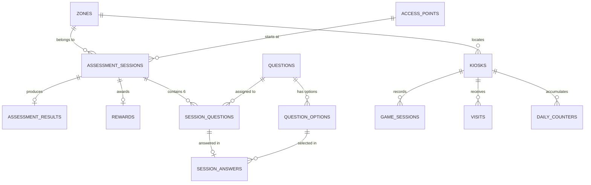

# Data Dictionary: Collaborative Community Literacy Assessment System

This document provides a comprehensive description of the relational database schema (PostgreSQL / SQLAlchemy ORM) of the **CCLAS** system, including catalog tables, the structured assessment workflow, the gamified workflow (*La Ruta de Nina*), anonymous visit metrics, primary and foreign keys, and integrity constraints (`CHECK` and `UNIQUE`).

> **Privacy by Design (Panama's Law 81):** No table stores Personally Identifiable Information (PII), such as names, national ID numbers, email addresses, phone numbers, IP addresses, or device fingerprints. All demographic and geographic data are recorded exclusively using closed canonical codes.

---

## 1. Geographic Catalogs and Access Points

### 1.1 Table: `zones`
Official catalog of community zones (`Z001`–`Z036`) and the special code `DECLINED`, used when a participant chooses not to share their location.

| Column | SQL Type | Nullable | Key / Index | Description and Constraints |
| :--- | :--- | :--- | :--- | :--- |
| `code` | `VARCHAR(4)` / `VARCHAR` | `NOT NULL` | **PK** | Canonical zone code (`Z001` to `Z036`, or `DECLINED`). |
| `name` | `VARCHAR(80)` | `NOT NULL` | — | Official name of the corregimiento or community zone. |
| `latitude` | `DOUBLE PRECISION` | `NULL` | — | Reference geographic latitude of the zone's centroid. |
| `longitude` | `DOUBLE PRECISION` | `NULL` | — | Reference geographic longitude of the zone's centroid. |

---

### 1.2 Table: `access_points`
Authorized access points from which assessment sessions are initiated.

| Column | SQL Type | Nullable | Key / Index | Description and Constraints |
| :--- | :--- | :--- | :--- | :--- |
| `code` | `VARCHAR` | `NOT NULL` | **PK** | Access point code: `'PTYK001'`, `'PTYK002'`, `'PTYK003'`, or `'DIRECT_WEB'`. |
| `name` | `VARCHAR` | `NOT NULL` | — | Descriptive name of the access point (`trim(name) != ''`). |
| `type` | `ENUM(AccessPointType)` | `NOT NULL` | — | Channel type: `'KIOSK'` or `'WEB'`. |

**`CHECK` constraints:**
- `ck_access_points_code`: `code IN ('PTYK001', 'PTYK002', 'PTYK003', 'DIRECT_WEB')`
- `ck_access_points_name`: `trim(name) != ''`
- `ck_access_points_code_type`: `(code = 'DIRECT_WEB' AND type = 'WEB') OR (code IN ('PTYK001', 'PTYK002', 'PTYK003') AND type = 'KIOSK')`

---

### 1.3 Table: `kiosks`
Catalog of physical kiosks (*Smart Oasis Kiosks*) and the web channel for the gamified workflow and visit counting.

| Column | SQL Type | Nullable | Key / Index | Description and Constraints |
| :--- | :--- | :--- | :--- | :--- |
| `code` | `VARCHAR(20)` | `NOT NULL` | **PK** | Kiosk identifier (e.g., `PTYK001`, `PTYK002`, `PTYK003`, `DIRECT_WEB`). |
| `name` | `VARCHAR(80)` | `NOT NULL` | — | Kiosk location name. |
| `zone_code` | `VARCHAR(4)` | `NULL` | **FK** → `zones.code`, **IDX** | Zone where the kiosk is located (`fk_kiosks_zone_code_zones`). |

---

## 2. Structured Assessment Workflow and Question Bank

### 2.1 Table: `assessment_sessions`
Records each assessment session initiated by a participant, along with their anonymous demographic profile.

| Column | SQL Type | Nullable | Key / Index | Description and Constraints |
| :--- | :--- | :--- | :--- | :--- |
| `session_id` | `INTEGER` | `NOT NULL` | **PK** | Unique auto-incrementing session identifier. |
| `access_point_code` | `VARCHAR` | `NOT NULL` | **FK** → `access_points.code` | Access point from which the session was initiated. |
| `assisted_mode` | `BOOLEAN` | `NOT NULL` | — | Indicates whether assistance from a facilitator was provided (`true`/`false`). |
| `age_range` | `ENUM(AgeRange)` | `NOT NULL` | — | Age range: `'18_24'`, `'25_34'`, `'35_49'`, `'50_59'`, `'60_PLUS'`. |
| `work_status` | `ENUM(WorkStatus)` | `NOT NULL` | — | Employment status: `'FORMAL'`, `'INFORMAL'`, `'HOME'`, `'STUDENT'`, `'UNEMPLOYED'`. |
| `schooling_level` | `ENUM(SchoolingLevel)` | `NOT NULL` | — | Education level: `'PRIMARY_INCOMPLETE'`, `'PRIMARY_COMPLETE'`, `'SECONDARY_INCOMPLETE'`, `'SECONDARY_COMPLETE'`, `'TERTIARY'`. |
| `zone_code` | `VARCHAR` | `NOT NULL` | **FK** → `zones.code` | Zone code (`Z001`–`Z036` or `'DECLINED'`). |
| `location_declined` | `BOOLEAN` | `NOT NULL` | — | `true` if and only if `zone_code = 'DECLINED'`. |
| `completion_status` | `ENUM(CompletionStatus)` | `NOT NULL` | — | Session status: `'IN_PROGRESS'`, `'COMPLETED'`, `'ABANDONED'`. |
| `duration_seconds` | `INTEGER` | `NOT NULL` | — | Total duration in seconds (`>= 0`). |

**`CHECK` constraints:**
- `ck_assessment_sessions_duration_seconds`: `duration_seconds >= 0`
- `ck_assessment_sessions_zone_location_declined`: `(zone_code = 'DECLINED' AND location_declined = true) OR (zone_code != 'DECLINED' AND location_declined = false)`

---

### 2.2 Table: `questions`
Question bank categorized by literacy competency.

| Column | SQL Type | Nullable | Key / Index | Description and Constraints |
| :--- | :--- | :--- | :--- | :--- |
| `id` | `INTEGER` | `NOT NULL` | **PK**, **IDX** | Unique question identifier. |
| `category` | `VARCHAR` | `NOT NULL` | — | Competency category: `'R1'`, `'R2'`, `'R3'`, `'R4'` (or `'test'`). |
| `question_text` | `VARCHAR` | `NULL` | — | Question prompt. |
| `assessment_id` | `INTEGER` | `NULL` | **FK** → `assessments.id` | Optional reference to a legacy assessment template. |
| `question_type` | `VARCHAR` | `NULL` | — | Question type (optional). |
| `correct_answer` | `VARCHAR` | `NULL` | — | Reference value for the correct answer (optional). |
| `points` | `INTEGER` | `NULL` | — | Points assigned to the question. |

**`CHECK` constraints:**
- `ck_questions_category`: `category IN ('R1', 'R2', 'R3', 'R4', 'test')`

---

### 2.3 Table: `question_options`
Answer options for each question in the bank.

| Column | SQL Type | Nullable | Key / Index | Description and Constraints |
| :--- | :--- | :--- | :--- | :--- |
| `id` | `INTEGER` | `NOT NULL` | **PK** | Unique option identifier. |
| `question_id` | `INTEGER` | `NOT NULL` | **FK** → `questions.id` | Question to which the option belongs. |
| `option_text` | `TEXT` | `NOT NULL` | — | Option text (`length(trim(option_text)) > 0`). |
| `is_correct` | `BOOLEAN` | `NOT NULL` | — | Indicates whether the option is correct (`DEFAULT false`). |

**Constraints and Indexes:**
- `uq_question_options_question_id_id`: `UNIQUE (question_id, id)` (supports the composite FK from `session_answers`).
- `ck_question_options_text_not_empty`: `CHECK (length(trim(option_text)) > 0)`
- `uq_one_correct_option_per_question`: Partial unique index (`WHERE is_correct = true`) that guarantees only one correct answer per question.

---

### 2.4 Table: `session_questions`
Assignment of the 6 selected questions to a specific assessment session.

| Column | SQL Type | Nullable | Key / Index | Description and Constraints |
| :--- | :--- | :--- | :--- | :--- |
| `session_id` | `INTEGER` | `NOT NULL` | **PK**, **FK** → `assessment_sessions.session_id` | Assessment session. |
| `question_id` | `INTEGER` | `NOT NULL` | **PK**, **FK** → `questions.id` | Question assigned to the session. |
| `position` | `INTEGER` | `NOT NULL` | — | Question presentation order (`1` to `6`). |

**Constraints:**
- `uq_session_question_position`: `UNIQUE (session_id, position)`
- `ck_session_question_position`: `CHECK (position BETWEEN 1 AND 6)`

---

### 2.5 Table: `session_answers`
Answers selected by the participant for each question assigned to their session.

| Column | SQL Type | Nullable | Key / Index | Description and Constraints |
| :--- | :--- | :--- | :--- | :--- |
| `session_id` | `INTEGER` | `NOT NULL` | **PK** | Session identifier. |
| `question_id` | `INTEGER` | `NOT NULL` | **PK** | Identifier of the answered question. |
| `option_id` | `INTEGER` | `NOT NULL` | — | Selected option. |

**Composite Foreign Keys:**
- `fk_session_answer_question`: `FOREIGN KEY (session_id, question_id) REFERENCES session_questions (session_id, question_id)`
- `fk_session_answer_option`: `FOREIGN KEY (question_id, option_id) REFERENCES question_options (question_id, id)` (ensures at the database engine level that the selected option belongs to that question).

---

### 2.6 Table: `assessment_results`
Scores broken down by competency and the final traffic-light classification of the assessment.

| Column | SQL Type | Nullable | Key / Index | Description and Constraints |
| :--- | :--- | :--- | :--- | :--- |
| `id` | `INTEGER` | `NOT NULL` | **PK**, **IDX** | Unique result identifier. |
| `session_id` | `INTEGER` | `NULL` | **FK** → `assessment_sessions.session_id` | Assessed session. |
| `submission_id` | `INTEGER` | `NULL` | **FK** → `assessment_submissions.id` | Optional legacy submission. |
| `c1_visual_signs_score` | `SMALLINT` | `NOT NULL` | — | C1 score: Visual Signs (`0` to `2`, `DEFAULT 0`). |
| `c2_sentence_comprehension_score` | `SMALLINT` | `NOT NULL` | — | C2 score: Sentence Comprehension (`0` to `2`, `DEFAULT 0`). |
| `c3_mobile_icons_score` | `SMALLINT` | `NOT NULL` | — | C3 score: Mobile Icons (`0` to `2`, `DEFAULT 0`). |
| `c4_cybersecurity_score` | `SMALLINT` | `NOT NULL` | — | C4 score: Cybersecurity (`0` to `3`, `DEFAULT 0`). |
| `total_literacy_score` | `SMALLINT` | `NOT NULL` | — | Cumulative total score (`0` to `9`, `DEFAULT 0`). |
| `literacy_classification` | `ENUM(LiteracyClassification)` | `NOT NULL` | — | Traffic-light classification: `'RED'` (`0–3`), `'YELLOW'` (`4–6`), `'GREEN'` (`7–9`). |
| `literacy_score` | `INTEGER` | `NULL` | — | Legacy compatibility field. |
| `total_score` | `INTEGER` | `NULL` | — | Legacy compatibility field. |
| `digital_score` | `INTEGER` | `NULL` | — | Legacy compatibility field. |
| `priority_level` | `INTEGER` | `NULL` | — | Intervention priority level (legacy compatibility). |

---

### 2.7 Table: `rewards`
Record of community rewards and IoT incentives issued upon session completion.

| Column | SQL Type | Nullable | Key / Index | Description and Constraints |
| :--- | :--- | :--- | :--- | :--- |
| `id` | `INTEGER` | `NOT NULL` | **PK** | Unique reward identifier. |
| `session_id` | `INTEGER` | `NOT NULL` | **FK** → `assessment_sessions.session_id`, **UNIQUE** | Associated session (maximum one reward per session). |
| `trigger_type` | `ENUM(TriggerType)` | `NOT NULL` | — | IoT activation type: `'BEVERAGE_DISPENSER'`, `'WIFI_CREDENTIAL'`, `'POWER_STATION'`, `'NONE'`. |
| `issued` | `BOOLEAN` | `NOT NULL` | — | Indicates whether the reward was actually issued. |

**`CHECK` constraints:**
- `ck_rewards_issued_trigger_type`: `(issued = false AND trigger_type = 'NONE') OR (issued = true AND trigger_type != 'NONE')`

---

## 3. Gamified PWA Workflow (*La Ruta de Nina*) and Visit Telemetry

### 3.1 Table: `game_sessions`
Autonomously and idempotently stores each anonymous game session submitted from the gamified PWA (`POST /api/sessions`).

| Column | SQL Type | Nullable | Key / Index | Description and Constraints |
| :--- | :--- | :--- | :--- | :--- |
| `session_id` | `VARCHAR(40)` | `NOT NULL` | **PK** | Random ID generated on the client (e.g., `SES-...`). |
| `kiosk_id` | `VARCHAR(20)` | `NOT NULL` | **FK** → `kiosks.code`, **IDX** | Kiosk or origin point (`fk_game_sessions_kiosk_id_kiosks`). |
| `origin` | `VARCHAR(10)` | `NOT NULL` | — | Session origin: `'KIOSK'`, `'UNKNOWN'`, `'MOCK'`. |
| `assisted_mode` | `BOOLEAN` | `NOT NULL` | — | Indicates whether the game was played in assisted mode (`DEFAULT false`). |
| `age_range` | `VARCHAR(10)` | `NULL` | — | `'18_24'`, `'25_34'`, `'35_49'`, `'50_59'`, `'60_PLUS'`. |
| `work_status` | `VARCHAR(15)` | `NULL` | — | `'FORMAL'`, `'INFORMAL'`, `'HOME'`, `'STUDENT'`, `'UNEMPLOYED'`. |
| `schooling_level` | `VARCHAR(25)` | `NULL` | — | `'PRIMARY_INCOMPLETE'`, `'PRIMARY_COMPLETE'`, `'SECONDARY_INCOMPLETE'`, `'SECONDARY_COMPLETE'`, `'TERTIARY'`. |
| `zone_code` | `VARCHAR(10)` | `NULL` | **IDX** | `'Z001'`–`'Z036'` or `'DECLINED'`. |
| `c1_visual_signs_score` | `SMALLINT` | `NOT NULL` | — | C1 score (`BETWEEN 0 AND 2`). |
| `c2_sentence_comprehension_score` | `SMALLINT` | `NOT NULL` | — | C2 score (`BETWEEN 0 AND 2`). |
| `c3_mobile_icons_score` | `SMALLINT` | `NOT NULL` | — | C3 score (`BETWEEN 0 AND 2`). |
| `c4_cybersecurity_score` | `SMALLINT` | `NOT NULL` | — | C4 score (`BETWEEN 0 AND 3`). |
| `total_literacy_score` | `SMALLINT` | `NOT NULL` | — | Exact sum of `c1 + c2 + c3 + c4` (`BETWEEN 0 AND 9`). |
| `internal_zone_classification` | `VARCHAR(6)` | `NOT NULL` | — | `'RED'` (`<= 3`), `'YELLOW'` (`4..6`), `'GREEN'` (`>= 7`). |
| `completion_status` | `VARCHAR(10)` | `NOT NULL` | — | `'COMPLETED'` or `'ABANDONED'`. |
| `last_step` | `VARCHAR(15)` | `NULL` | — | Last step reached before finishing or abandoning the game. |
| `duration_seconds` | `INTEGER` | `NOT NULL` | — | Duration in seconds (`>= 0`). |
| `reward_issued` | `BOOLEAN` | `NOT NULL` | — | Indicates whether a reward was granted (`DEFAULT false`). |
| `iot_trigger_type` | `VARCHAR(20)` | `NOT NULL` | — | `'NONE'`, `'BEVERAGE_DISPENSER'`, `'POWER_STATION'`, `'WIFI_CREDENTIAL'`. |
| `repeat_device` | `BOOLEAN` | `NOT NULL` | — | Indicates whether the browser had already claimed a reward within the previous 24 hours. |
| `created_at` | `TIMESTAMPTZ` | `NOT NULL` | — | Creation timestamp (`DEFAULT NOW()`). |

---

### 3.2 Table: `visits`
Anonymous record of website visits for people who accept the privacy notice and are over 18 years old.

| Column | SQL Type | Nullable | Key / Index | Description and Constraints |
| :--- | :--- | :--- | :--- | :--- |
| `visit_id` | `VARCHAR(40)` | `NOT NULL` | **PK** | Random visit identifier generated on the client. |
| `kiosk_id` | `VARCHAR(20)` | `NOT NULL` | **FK** → `kiosks.code`, **IDX** | Kiosk where the visit was recorded. |
| `origin` | `VARCHAR(10)` | `NOT NULL` | — | `'KIOSK'` or `'UNKNOWN'`. |
| `assisted_mode` | `BOOLEAN` | `NOT NULL` | — | Indicates whether assisted mode was active (`DEFAULT false`). |
| `outcome` | `VARCHAR(12)` | `NOT NULL` | — | Progress status: `'ENTERED'`, `'CONSENTED'`, `'ABANDONED'`, `'COMPLETED'`. |
| `session_id` | `VARCHAR(40)` | `NULL` | **IDX** | Optional logical link to `game_sessions.session_id`. |
| `first_seen_at` | `TIMESTAMPTZ` | `NOT NULL` | — | Visit start date/time (`DEFAULT NOW()`). |
| `updated_at` | `TIMESTAMPTZ` | `NOT NULL` | — | Date/time of the last update (`DEFAULT NOW()`). |

---

### 3.3 Table: `daily_counters`
Daily aggregated count of people who decline privacy consent (`DECLINED_PRIVACY`) or indicate that they are under 18 (`UNDER_18`). Complies with Law 81 by not retaining individual rows for these cases.

| Column | SQL Type | Nullable | Key / Index | Description and Constraints |
| :--- | :--- | :--- | :--- | :--- |
| `day` | `DATE` | `NOT NULL` | **PK (1/3)** | Date of the aggregated count. |
| `kiosk_id` | `VARCHAR(20)` | `NOT NULL` | **PK (2/3)**, **FK** → `kiosks.code` | Associated kiosk. |
| `outcome` | `VARCHAR(16)` | `NOT NULL` | **PK (3/3)** | Exit reason: `'DECLINED_PRIVACY'` or `'UNDER_18'`. |
| `entries` | `INTEGER` | `NOT NULL` | — | Accumulated count for the day (`entries >= 0`). |

---

## 4. Legacy Compatibility Tables

To maintain compatibility with the project's initial migrations, the schema also includes the following ORM entities:

- **`locations`** (`id` PK, `country`, `city`, `zone_name`)
- **`demographic_profiles`** (`id` PK, `age_group`, `education_level`, `employment_status`)
- **`assessments`** (`id` PK, `title`, `description`, `assessment_type`)
- **`assessment_submissions`** (`id` PK, `assessment_id` FK, `demographic_profile_id` FK, `location_id` FK, `started_at`, `completed_at`, `consent_given`)
- **`answers`** (`id` PK, `question_id` FK, `submission_id` FK, `is_correct`, `answer_value`, `points_awarded`)

---

## 5. Entity-Relationship Diagram (Mermaid)

